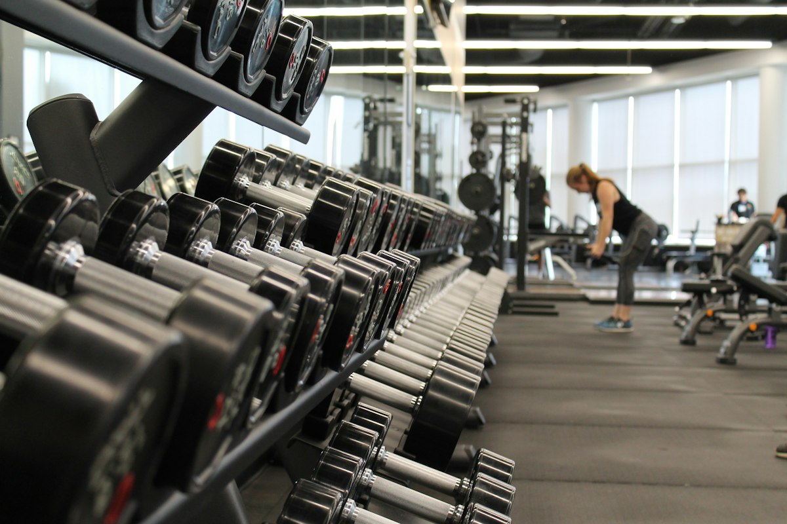
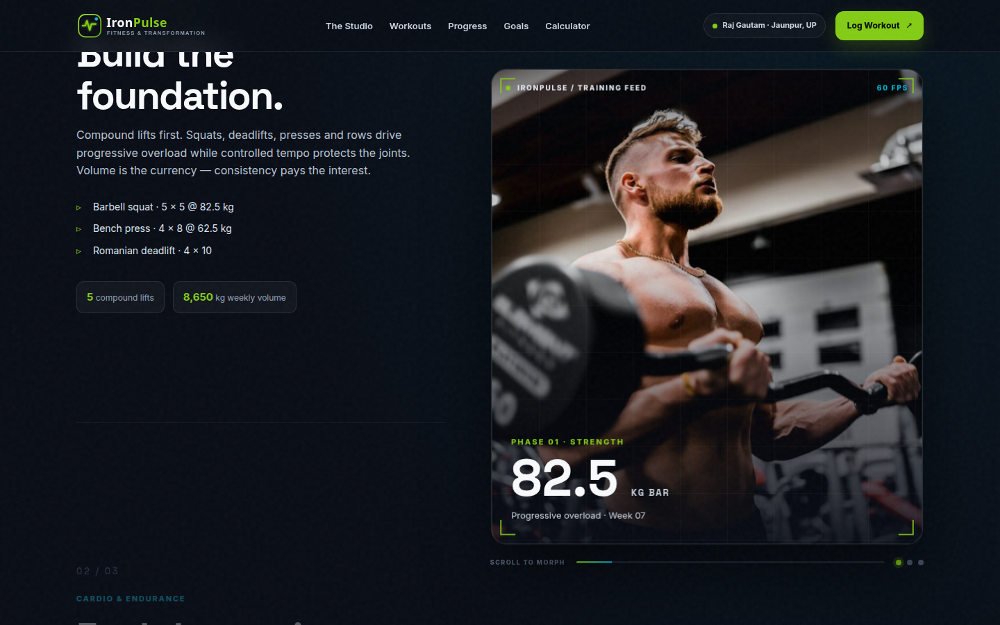
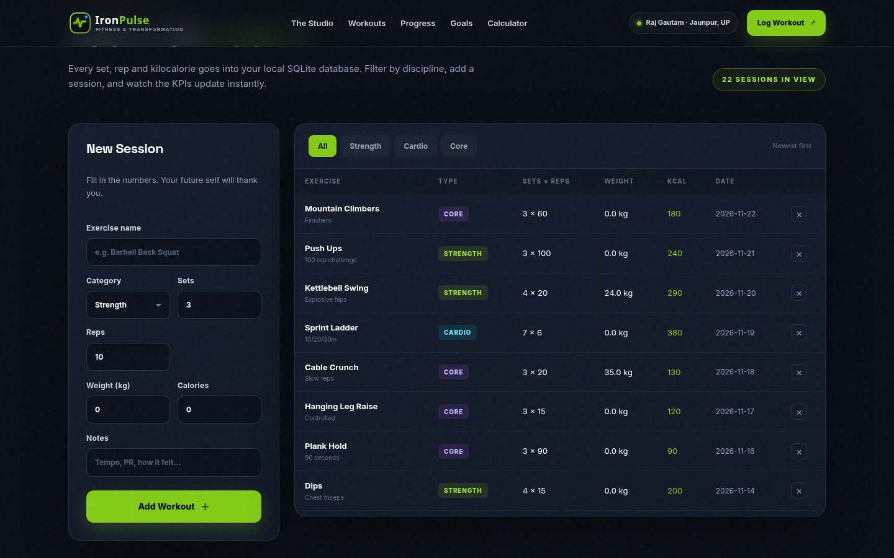
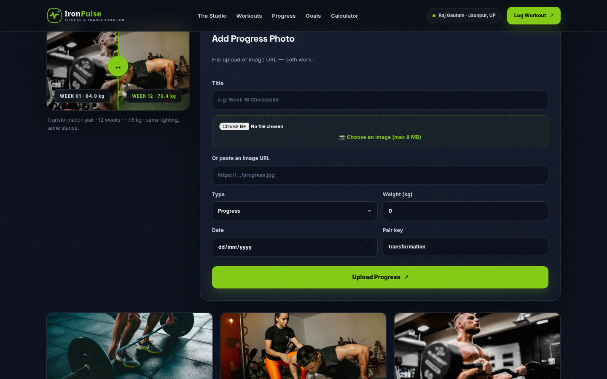
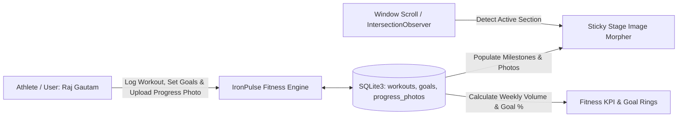

<div align="center">


# IronPulse

**Workouts, Scroll-Morph Progress & Fitness Goal Studio**

*Engineered by [Raj Gautam](https://github.com/Rg100152) · Jaunpur, Uttar Pradesh, India*

[](https://www.python.org/)
[](https://flask.palletsprojects.com/)
[](https://www.sqlite.org/)
[](https://developer.mozilla.org/)
[](LICENSE)
[](https://www.instagram.com/linux.userraj)

**A next-gen fitness tracker where scrolling literally morphs your training story.**  
No heavy 3D libraries. No phone number. Just Flask, SQLite, sticky CSS and 60fps IntersectionObserver magic.

</div>

---



---

## ⚡ What makes IronPulse different?

| Feature | What it does |
|---|---|
| **Scroll-Driven Image Morphing** | A pinned right-hand stage cross-fades and zooms through **Strength → Cardio → Transformation** as you scroll the story on the left. Powered by `IntersectionObserver` + CSS `position: sticky`. |
| **Before / After Slider** | Drag the volt-lime handle to reveal a 12-week transformation. Upload your own photo by **file or URL** with weight + date captions. |
| **Workout Logger** | Log exercise, category, sets, reps, weight (kg), calories and notes. Filter by discipline, delete entries, watch KPIs update. |
| **Goal Studio** | Animated conic-gradient goal rings for target weight, 100-pushup streak, 5K time, weekly volume and body fat. Update progress in one click. |
| **Body Metrics Calculator** | BMI, BMR (Mifflin–St Jeor), TDEE, cut and lean-gain calorie targets — computed 100% in the browser. |
| **Live KPIs** | Total workouts, lifetime volume, calories, 7-day volume and current training streak, all from SQLite. |

---

## 📸 Screenshots

<div align="center">

<table>
  <tr>
    <td width="50%" align="center"><b>Scroll-Morph Sticky Stage</b><br/></td>
    <td width="50%" align="center"><b>Workout Logger &amp; Tracker</b><br/></td>
  </tr>
  <tr>
    <td colspan="2" align="center"><b>Before / After Progress Studio</b><br/></td>
  </tr>
</table>

<sub>Real headless-Chrome captures of the running app — not mockups.</sub>

</div>

---

## 🧠 How the scroll morph works

1. The page is split into a **scrollable story column** (left) and a **sticky stage column** (right).
2. `IntersectionObserver` watches each `.story-step`. Whichever step owns the viewport becomes active.
3. The active index toggles `.is-active` on the matching stage image → CSS cross-fades `opacity` and scales `transform`.
4. A rAF-throttled scroll handler drives the progress rail and a subtle stage zoom. No layout thrash, no jank on a 4GB laptop.

---

## 🔄 Data Flow Diagram



---

## 📁 Project structure

```
ironpulse/
├── app.py                      # Flask server, REST APIs, SQLite helpers
├── seed_fitness.py             # 22 workouts, 5 goals, 3 progress milestones
├── requirements.txt            # Flask
├── README.md                   # This file
├── RUN_ME.txt                  # Copy-paste setup commands
├── .gitignore
├── database/
│   └── ironpulse.db            # Created automatically on first run
├── templates/
│   ├── base.html               # Kinetic navbar + developer footer
│   └── index.html              # Morph stage, logger, photos, goals, calculator
└── static/
    ├── css/ironpulse.css       # Volt-lime + carbon design system
    ├── js/scrollMorph.js       # Morph switcher, slider, forms, calculator
    ├── uploads/                # Your uploaded progress photos
    └── assets/
        ├── logo-ironpulse.svg  # Custom dumbbell + heartbeat pulse logo
        ├── banner.jpg
        ├── stage-1.jpg         # Strength
        ├── stage-2.jpg         # Cardio
        ├── stage-3.jpg         # Transformation
        ├── screenshot-scroll.png
        ├── screenshot-tracker.png
        └── screenshot-photos.png
```

---

## 🚀 Quick start (copy-paste)

```bash
# 1. Install dependencies
python3 -m venv .venv
source .venv/bin/activate          # Windows: .venv\Scripts\activate
pip install -r requirements.txt

# 2. Fill the database with sample data
python3 seed_fitness.py

# 3. Start the app
python3 app.py
```

Open **http://127.0.0.1:5000** in your browser. Done. 🎉

> Already have Flask installed? Just run `python3 seed_fitness.py` then `python3 app.py`.

### One-line version (Linux / macOS)

```bash
python3 -m venv .venv && source .venv/bin/activate && pip install -r requirements.txt && python3 seed_fitness.py && python3 app.py
```

### Windows (PowerShell)

```powershell
python -m venv .venv
.\.venv\Scripts\Activate.ps1
pip install -r requirements.txt
python seed_fitness.py
python app.py
```

Everything else (`RUN_ME.txt`) is ready for copy-paste too.

---

## 🔌 API endpoints

| Method | Endpoint | Purpose |
|---|---|---|
| `GET` | `/` | Dashboard with workouts, goals, photos and KPIs |
| `GET` | `/?category=Cardio#logger` | Filter workout log |
| `POST` | `/api/workouts` | Add a workout |
| `DELETE` | `/api/workouts/<id>` | Remove a workout |
| `POST` | `/api/goals` | Create a goal |
| `POST` | `/api/goals/<id>/progress` | Update goal progress |
| `DELETE` | `/api/goals/<id>` | Remove a goal |
| `POST` | `/api/photos` | Upload progress photo (multipart or URL) |
| `DELETE` | `/api/photos/<id>` | Remove a photo |
| `GET` | `/api/stats` | Live KPI JSON |

---

## 🛠️ Optional: re-download the stock images

All images are already bundled, but if you want fresh copies:

```bash
mkdir -p static/assets static/uploads
curl -L "https://images.unsplash.com/photo-1534438327276-14e5300c3a48?auto=format&fit=crop&w=1200&q=80" -o static/assets/banner.jpg
curl -L "https://images.unsplash.com/photo-1581009146145-b5ef050c2e1e?auto=format&fit=crop&w=900&q=80" -o static/assets/stage-1.jpg
curl -L "https://images.unsplash.com/photo-1517836357463-d25dfeac3438?auto=format&fit=crop&w=900&q=80" -o static/assets/stage-2.jpg
curl -L "https://images.unsplash.com/photo-1571019614242-c5c5dee9f50b?auto=format&fit=crop&w=900&q=80" -o static/assets/stage-3.jpg
```

---

## 👨‍💻 Developer

<div align="center">

**Raj Gautam** · Jaunpur, Uttar Pradesh, India  
📧 [graj13099@gmail.com](mailto:graj13099@gmail.com)  
📸 [@linux.userraj](https://www.instagram.com/linux.userraj)  
🐙 [github.com/Rg100152](https://github.com/Rg100152)

*No phone number is included in this project — by design.*

</div>

---

## 📄 License

MIT — fork it, ship it, make it yours. Star the repo if the scroll morph made you smile ⭐

<p align="center"><b>Train harder. Morph stronger.</b></p>
